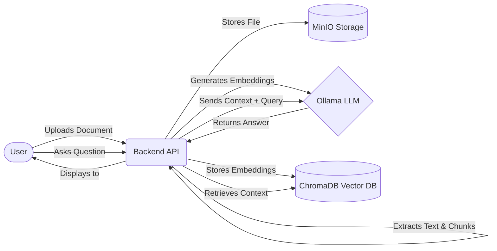

<h1 align="center">🧠 IntelliDocs AI</h1>

<p align="center">
  <strong>An AI-powered Document Intelligence Platform with advanced RAG (Retrieval-Augmented Generation) capabilities.</strong>
</p>

<p align="center">
  
  
  
  
</p>

---

## 🚀 Overview

**IntelliDocs AI** transforms static documents into interactive knowledge bases. By leveraging LLMs and vector embeddings, it allows users to "chat" with their documents, extract key insights, and automate information retrieval across massive datasets.

### ✨ Key Features

- **Hybrid RAG Pipeline:** Combines semantic vector search with keyword matching for highly accurate document retrieval.
- **Multi-Format Support:** Ingests PDF, DOCX, TXT, and CSV files seamlessly.
- **Contextual Memory:** Maintains conversation history for multi-turn reasoning about document contents.
- **Containerized Architecture:** Fully dockerized for isolated, reproducible deployments.

---

## 📐 Architecture

IntelliDocs AI leverages a robust, containerized architecture to process documents and orchestrate the RAG pipeline.
- **Vector Database**: **ChromaDB** is used to store and query document embeddings.
- **LLM Orchestration**: **Ollama** runs locally (defaulting to Llama 2), with optional fallbacks to Groq or Google Gemini.
- **Storage**: **MinIO** handles S3-compatible object storage for uploaded documents.
- **Core DB & Cache**: **PostgreSQL** and **Redis**.
- **Frontend (`/frontend`):** A modern, responsive React interface.
- **Backend (`/backend`):** A Node.js/TypeScript service.



---

## 🛠️ Quick Start

### Prerequisites
Before you begin, ensure you have the following installed on your system:
- [Docker](https://docs.docker.com/get-docker/)
- [Docker Compose](https://docs.docker.com/compose/install/)

### 1. Environment Setup
Copy the example environment file and add your LLM API keys:
```bash
cp .env.example .env
# Edit .env with your credentials
```

### 2. Launch Platform
The fastest way to get started is using Docker Compose:
```bash
docker-compose up --build -d
```

- **Frontend UI:** `http://localhost:3000`
- **Backend API:** `http://localhost:8080`

---

## 💻 Usage

Once the platform is running:
1. Open the **Frontend UI** in your browser.
2. **Upload a Document** (PDF, TXT, DOCX, or CSV) via the drag-and-drop interface.
3. Wait a few seconds for the document to be processed and vectorized.
4. **Start Chatting**: Use the chat input at the bottom of the screen to ask questions about your document!

```text
+-------------------------------------------------------------+
| 🧠 IntelliDocs AI                                  [Logout] |
|-------------------------------------------------------------|
|                                                             |
|  [ Upload Document (PDF, TXT, DOCX, CSV) 📁 ]               |
|                                                             |
|  Current Document: quarterly_report.pdf (Processed ✓)       |
|                                                             |
|  ---------------------------------------------------------  |
|  | User: What were the key revenue drivers?              |  |
|  |                                                       |  |
|  | AI: Based on the document, the key revenue drivers    |  |
|  | were Q3 enterprise sales and the new cloud API...     |  |
|  ---------------------------------------------------------  |
|                                                             |
|  [ Ask a question about your document...             ] [->] |
+-------------------------------------------------------------+
```

---

## 📈 Current Status
Check [CURRENT_STATUS.md](CURRENT_STATUS.md) for the latest development updates, known limitations, and immediate next steps in the sprint.

---

## 🤝 Contributing
Contributions are welcome! Please feel free to submit a Pull Request.
1. Fork the repository
2. Create your feature branch (`git checkout -b feature/AmazingFeature`)
3. Commit your changes (`git commit -m 'Add some AmazingFeature'`)
4. Push to the branch (`git push origin feature/AmazingFeature`)
5. Open a Pull Request

---

## 📄 License
This project is licensed under the MIT License - see the LICENSE file for details.
