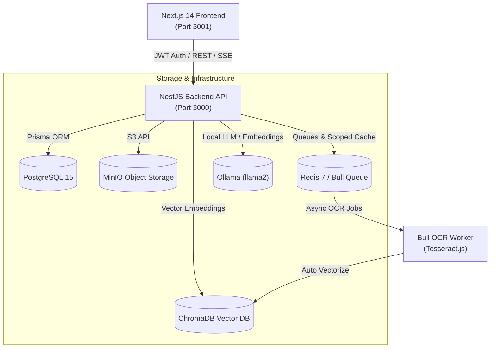

<h1 align="center">🧠 IntelliDocs AI</h1>

<p align="center">
  <strong>Production-Grade Multi-Tenant Document Intelligence & RAG Platform</strong>
</p>

<p align="center">
  
  
  
  
  
  
  
</p>

---

## 🚀 Overview

**IntelliDocs AI** is an enterprise-grade document intelligence platform that enables secure, multi-tenant document ingestion, optical character recognition (OCR), semantic search, and Retrieval-Augmented Generation (RAG).

Users can upload PDF documents, extract text from scanned pages via automated background OCR workers, perform hybrid keyword-vector search, and query their knowledge base with grounded citations pointing to exact source pages.

---

## ✨ Key Capabilities

- **Hybrid RAG Pipeline:** Dense semantic vector retrieval (ChromaDB) fused with lexical keyword search using Reciprocal Rank Fusion (RRF).
- **Background OCR Pipeline:** Asynchronous document processing via Bull queue and Redis, combining fast PDF text extraction (`pdf-parse`) with automated OCR fallback (`Tesseract.js`) for scanned documents.
- **Strict Multi-Tenant Isolation:** Complete data separation across PostgreSQL (Prisma), MinIO object storage, ChromaDB vector collections, and Redis caching.
- **Grounded Citations & Prompt Defenses:** RAG answers strictly reference `<document_context>` passages with page numbers, accompanied by prompt injection defenses.
- **PDF Manipulation Toolkit:** High-performance PDF merging, page splitting, and image-to-PDF compilation with DoS and memory exhaustion guards.
- **AI Content Analysis:** Stylometric text analyzer evaluating perplexity, burstiness, and repetitive phrase structures.
- **Resume & Job Matcher:** Contextual resume analysis matching candidate qualifications against job descriptions.
- **Local RAGAS Evaluation Runner:** Evaluates RAG pipelines locally using Faithfulness, Answer Relevance, Context Recall, and Context Precision benchmarks without fabricated scores.

---

## 📐 Architecture



---

## 🛠️ Quick Start

### Prerequisites
- [Docker](https://docs.docker.com/get-docker/) & [Docker Compose](https://docs.docker.com/compose/)
- [Node.js](https://nodejs.org/) v20+ (for local development)

### 1. Environment Configuration
Copy the configuration template:
```bash
cp .env.example .env
```
*(Customize passwords and secrets in `.env` before starting).*

### 2. Launch Services with Docker Compose
```bash
docker compose up -d
```

| Service | Local URL / Port | Description |
|---|---|---|
| **Frontend UI** | `http://localhost:3001` | Next.js 14 web client |
| **Backend API** | `http://localhost:3000` | NestJS REST API server |
| **MinIO Console** | `http://localhost:9001` | S3 Storage Dashboard (`minioadmin`) |
| **ChromaDB** | `http://localhost:8000` | Vector database |
| **Ollama** | `http://localhost:11434` | Local LLM inference server |

---

## 💻 Local Development (Bare Metal)

If running outside Docker:

```bash
# 1. Install dependencies
npm --prefix backend install
npm --prefix frontend install

# 2. Generate Prisma Client
npx --prefix backend prisma generate

# 3. Start Backend (runs on port 3000)
npm --prefix backend run start:dev

# 4. Start Frontend (runs on port 3001)
npm --prefix frontend run dev
```

---

## 🧪 Testing & Verification

IntelliDocs AI includes comprehensive automated test suites covering authentication, multi-tenant isolation, caching, and document manipulation:

```bash
# Run backend test suites
npm --prefix backend test

# Run frontend test suites
npm --prefix frontend test

# Run full project type check & lint
npm --prefix backend run build
npm --prefix backend run lint
npm --prefix frontend run build
npm --prefix frontend run lint
```

Refer to [TESTING_GUIDE.md](./TESTING_GUIDE.md) for detailed verification workflows and multi-tenant security verification instructions.

---

## 🔒 Security & Multi-Tenancy

- **No Shared Vector Leakage:** ChromaDB vector embeddings require explicit `userId` tags, and vector searches strictly filter by document IDs owned by the authenticated tenant.
- **Tenant-Scoped Redis Caching:** Keys are isolated via `search:<userId>:<hash>` and `llm:<userId>:<hash>`.
- **Infrastructure Hardening:** All container ports in `docker-compose.yml` are bound exclusively to `127.0.0.1` loopback to prevent exposure across public network interfaces.
- **Resource Exhaustion Guards:** Upload and PDF processing operations enforce strict upper bounds (max 50MB per file, max 20 merge files, max 50 split segments).

---

## 📄 License
UNLICENSED — IntelliDocs AI
